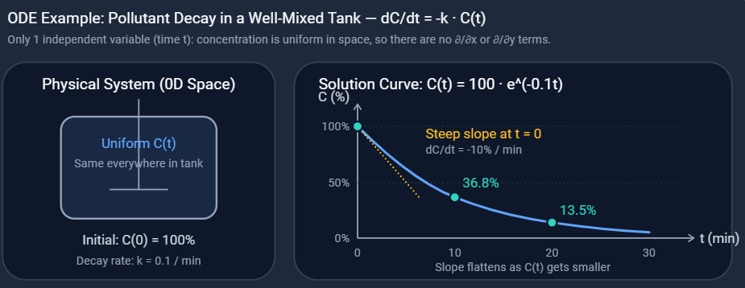
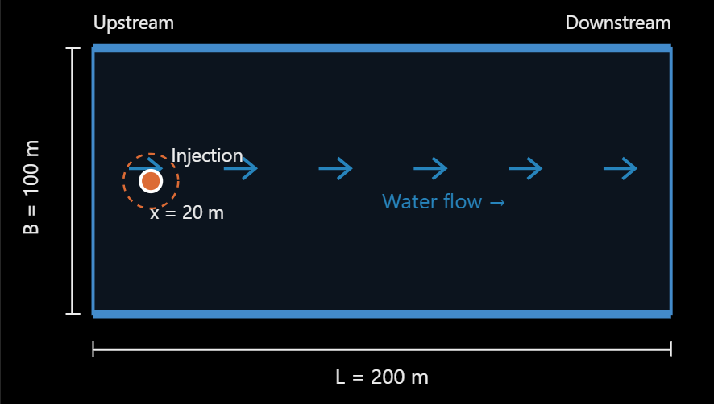
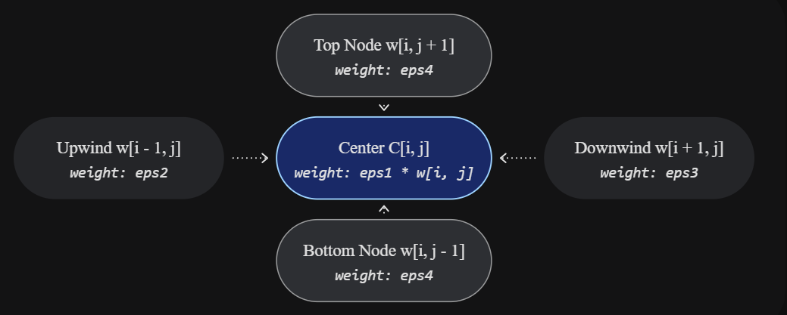
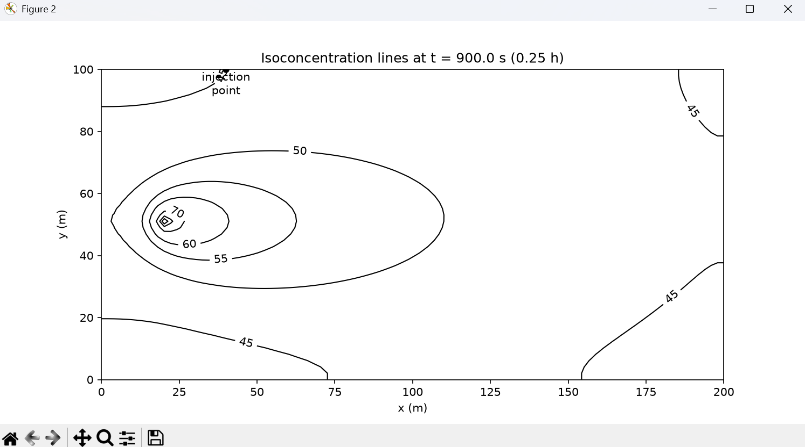

# Numerical Modeling of 2D Pollutant Dispersion in Rivers: Explicit Upwind Finite Difference Method

In this project, I use the example in Chapter 15 of the Marcello Benedini and George Tsakiris book and implement the same methodology to build the Python code.

Before introducing the example, let’s first understand some basic concept we are going to use throughout the project.

There are three ways to build a model: the hydraulic model, analogical model, and numerical model. The hydraulic model is a small laboratory model with similar geometry and dynamics (like similar Froude number and Reynolds number), while an analogical model uses a completely different physical model that follows mathematically equivalent equations to represent a system, such as using Ohm’s law to represent groundwater flow.

A mathematical model describes a real-world system using governing equations (partial differential equations) and solves them using analytical or numerical methods.

**Governing equation:** A partial differential equation (PDE) that describes how a physical system behaves, as each phenomenon has physical laws that govern its behavior. One of the most famous governing equations is the Navier–Stokes equations, which are simply the fundamental partial differential equations that describe how fluids (liquids and gases) move.

Before describing the advection-dispersion equation, let’s remember the meaning of a differential equation.

**Differential equation:** An equation that relates an unknown function to one or more of its derivatives. It describes how a quantity changes with respect to one or more independent variables.

If there is only one independent variable, it is called an ordinary differential equation (ODE), but if there is more than one independent variable, it is called a partial differential equation (PDE).

A well-mixed tank with a decaying pollutant is one of the clearest examples of an Ordinary Differential Equation (ODE).

Because a mixer keeps the water completely uniform everywhere inside the tank, concentration does not depend on position $(x, y, z)$; it depends on only one independent variable: time $t$. That is why we use an ordinary derivative $\frac{dC}{dt}$ instead of a partial derivative $\frac{\partial C}{\partial t}$.

$$
\frac{dC}{dt} = -k\,C(t)
$$

* $C(t)$: Pollutant concentration (%) at time $t$ (minutes).
* $\frac{dC}{dt}$: How fast the concentration is dropping per minute (the slope of the curve).
* $-k\,C(t)$: The minus sign means concentration decreases, and multiplying by $k$ means when there is a lot of pollutant, it decays fast; as less remains, the decay slows down.

The advection-dispersion equation is a partial differential equation and consists of:

* **Advective Flux ($u\,C$):** Pollutant physically carried along by the bulk river speed $u$.
* **Dispersive Flux ($-E\frac{\partial C}{\partial x}$):** Fick's First Law, pollutant spreading from high concentration to low concentration (hence the minus sign) due to turbulent eddies and mixing.

$$
\underbrace{\frac{\partial C}{\partial t}}_{\text{1. Storage}} + \underbrace{u\frac{\partial C}{\partial x}}_{\text{2. Advection}} = \underbrace{E\frac{\partial^2 C}{\partial x^2}}_{\text{3. Dispersion}} - \underbrace{kC}_{\text{4. Decay}}
$$

* **Local Accumulation ($\frac{\partial C}{\partial t}$):** How fast concentration rises or falls at a fixed point over time. If the plume has reached steady state, this term is $0$.
* **Advection ($u\frac{\partial C}{\partial x}$):** Downstream transport by the main current. If $E = 0$ and $k = 0$, the equation becomes $\frac{\partial C}{\partial t} + u\frac{\partial C}{\partial x} = 0$, a pure wave moving downstream at speed $u$ without changing shape.
* **Dispersion ($E\frac{\partial^2 C}{\partial x^2}$):** Longitudinal mixing and dilution. The dispersion coefficient $E$ ($\text{m}^2/\text{s}$) combines molecular diffusion, turbulent eddies, and shear-flow stretching. Where concentration peaks sharply, $\frac{\partial^2 C}{\partial x^2}$ is negative, so dispersion lowers the peak and widens the cloud.
* **Reaction / Decay ($-kC$):** First-order chemical breakdown, biodegradation, or radioactive decay ($k = 0$ for a conservative tracer).

For a 3D model, the equation becomes:

$$
\frac{\partial C}{\partial t} + u\frac{\partial C}{\partial x} + v\frac{\partial C}{\partial y} + w\frac{\partial C}{\partial z} = E_x\frac{\partial^2 C}{\partial x^2} + E_y\frac{\partial^2 C}{\partial y^2} + E_z\frac{\partial^2 C}{\partial z^2} - kC
$$

To tell whether a river is advection-dominated or dispersion-dominated, engineers compute the Péclet number:

$$
\text{Pe} = \frac{u\,L}{E} \qquad \left(\text{or on a numerical grid: } \text{Pe}_{\text{grid}} = \frac{u\,\Delta x}{E}\right)
$$

* $\text{Pe} \gg 1$ **(Advection-dominated):** Fast river, low mixing. The pollutant travels as a tight, sharp plume downstream (harder for central FDM schemes unless you use Upwind or small $\Delta x$).
* $\text{Pe} \ll 1$ **(Dispersion-dominated):** Slow or stagnant water, strong mixing. The pollutant spreads outward in all directions like ink in a still pond.
* **In our case study ($u = 1\text{ m/s}$, $\Delta x = 2\text{ m}$, $E = 5\text{ m}^2/\text{s}$):** $\text{Pe}_{\text{grid}} = \frac{1 \times 2}{5} = 0.4 \le 2$, which is why our grid stayed completely smooth and oscillation-free.

## Case Study Example

Okay, now let’s introduce the example:

A pollutant is discharged continuously into a river with a $100\text{ m}$ width and $200\text{ m}$ length, at $20\text{ m}$ from upstream and in the center of the cross-section. Water flows in the longitudinal direction ($u = 1.0\text{ m/s}$), carrying the pollutant downstream through advection with negligible cross-sectional movement ($v = 0$). At the same time, molecular and turbulent dispersion spread the pollutant both longitudinally and laterally ($E = 5\text{ m}^2/\text{s}$). The river depth is shallow, so the model assumes that velocity and concentration are depth-averaged. Consequently, the domain represents the horizontal river plane rather than the complete three-dimensional river.

The computational domain is discretized using a uniform grid with spatial steps of $2\text{ m}$ in both directions and a time step of $0.1\text{ s}$, and it runs for $15\text{ min}$.

### Simplification Assumptions

* **Homogeneous Isotropic Dispersion & Conservative Tracer:** The dispersion coefficient $E$ is constant and equal in both longitudinal and lateral directions ($E_x = E_y = E$), and the pollutant does not undergo chemical decay.
* **Steady, Unidirectional Parallel Channel Flow ($\frac{\partial u}{\partial t} = 0$, $v = 0$):** The river channel has straight, parallel banks of constant width $h$, and the transverse velocity component $v$ is practically zero. Consequently, longitudinal velocity varies solely with transverse distance across the gap: $u = u(y)$.
* **Initial Condition ($t = 0$):** Prior to discharge, the river is uncontaminated ($C(x, y, 0) = 0\%$) at all interior and boundary nodes, except at the injection point ($C(x, y, t) = 100\%$).

The illustration of the case study:

### List of Parameters

| Parameter | Value |
| :--- | :--- |
| River length, $L$ | $200\text{ m}$ |
| River width, $B$ | $100\text{ m}$ |
| Longitudinal velocity, $u$ | $1.0\text{ m/s}$ |
| Transverse velocity, $v$ | $0\text{ m/s}$ |
| Dispersion coefficient, $E$ | $5\text{ m}^2/\text{s}$ |
| Source location, $x_s$ | $20\text{ m}$ |
| Source location, $y_s$ | $50\text{ m}$ |
| Source concentration | $100\%$ |
| Injection duration | Continuous |

### Numerical Method

Now, to solve the problem, we use the explicit upwind finite difference numerical method.

The equation below is derived when the vertical velocity is zero and the dispersion coefficient $E$ is significant:

$$
C_{i,j}^{t+1} = \varepsilon_1 C_{i,j}^t + \varepsilon_2 C_{i-1,j}^t + \varepsilon_3 C_{i+1,j}^t + \varepsilon_4 \left(C_{i,j-1}^t + C_{i,j+1}^t\right)
$$

$$
\varepsilon_1 = \Delta t\left[\frac{1}{\Delta t} - \frac{u}{\Delta x} - 2E\left(\frac{1}{\Delta x^2} + \frac{1}{\Delta y^2}\right)\right]
$$

$$
\varepsilon_2 = \Delta t\left(\frac{u}{\Delta x} + \frac{E}{\Delta x^2}\right), \qquad \varepsilon_3 = \frac{\Delta t\,E}{\Delta x^2}, \qquad \varepsilon_4 = \frac{\Delta t\,E}{\Delta y^2}
$$

### Boundary Conditions

* **Dirichlet Boundary Condition at the Injection Point:** A continuous pollutant source is injected at coordinates $(20, 50)$ with a fixed concentration $C(20, 50, t) = 100\%$ for infinite duration.
* **Neumann Zero-Gradient Boundary Conditions at Outer Boundaries:** Because the lateral riverbanks ($y = 0$ and $y = h$) are impermeable solid boundaries, no pollutant mass can cross them, requiring a zero normal concentration gradient ($\frac{\partial C}{\partial y} = 0$). Similarly, the upstream ($x = 0$) and downstream ($x = L$) cross-sections satisfy homogeneous Neumann conditions ($\frac{\partial C}{\partial x} = 0$).

**Bottom and Top Riverbanks** (`River_grid[:, 0] = River_grid[:, 1]` and `River_grid[:, -1] = River_grid[:, -2]`):

* Sets $\frac{\partial C}{\partial y} = 0$ along $y = 0\text{ m}$ and $y = 100\text{ m}$. Physically, this means the riverbanks are impermeable solid walls, so no pollutant can pass through the banks.

**Upstream and Downstream Boundaries** (`River_grid[0, :] = River_grid[1, :]` at $x = 0\text{ m}$ and `River_grid[-1, :] = River_grid[-2, :]` at $x = 200\text{ m}$):

* Sets $\frac{\partial C}{\partial x} = 0$ along $x = 0\text{ m}$ and $x = 200\text{ m}$. Physically, this is the standard free-exit (convective outflow / open discharge) boundary condition. Because $\frac{\partial C}{\partial x} = 0$, the diffusive flux $-E\frac{\partial C}{\partial x}$ across the outlet is zero, while the river velocity $u$ freely carries the pollutant out of the domain at rate $u \cdot C$ without reflecting it back.

## Results & Code

The code attached below ([`Pollution_Dispersion_2D_River.py`](Pollution_Dispersion_2D_River.py)) solves this problem and generates a video showing the dispersion of pollution along the river over a 15-minute duration, along with the contour lines for the dispersion at 15 min:

### Simulation Animation (15 Minutes)

https://github.com/user-attachments/assets/3fe45385-85c9-4ce0-8398-688b6e2a1c0e

